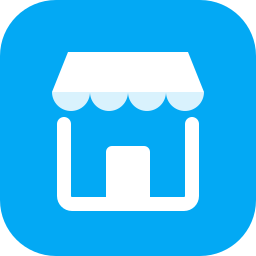

  

# Marketplace Shortcut for Home Assistant

🇬🇧 English · 🇫🇷 [Français](README.fr.md)

Adds a **Marketplace** entry to the Home Assistant sidebar. A path inside Home Assistant (e.g. `/marketplace/browse`) opens that page directly in Home Assistant.

## Requirements

Home Assistant **2026.11** or newer (the release that introduced the built-in Marketplace).

## Installation

### With the Marketplace (recommended)

The built-in Marketplace replaces HACS. This integration is added as a custom repository, which requires [connecting GitHub](https://www.home-assistant.io/integrations/marketplace/#connecting-github) to the Marketplace.

1. Click the button above. Or go to **Settings → Marketplace → Add from link**, enter `https://github.com/aubierr/ha-marketplace-shortcut` and select **Add**.
2. Install **Marketplace Shortcut**, then restart Home Assistant.
3. Add the integration:

   

### Manually

1. Copy `custom_components/marketplace_shortcut` into your `config/custom_components/` folder.
2. Restart Home Assistant.
3. **Settings → Devices & services → Add integration → Marketplace Shortcut**.

## Options

- **Title** and **icon** (`mdi:store` by default) of the sidebar entry.
- **URL** of the marketplace.
- **Open mode** (for external URLs):
  - *iframe*: shown inside Home Assistant (only works if the site allows being embedded; an `http://` site is blocked when HA runs on HTTPS).
  - *new tab*: opens the URL in a new browser tab (use it if the site refuses iframes).
- **Admins only**.

Everything can be changed later with the integration's **Configure** button. Users can also hide the sidebar entry in their profile.

## License

MIT, see [LICENSE](LICENSE).

## Translations

The configuration screens are translated into 31 languages: English, French, German, Spanish, Italian, Portuguese (PT/BR), Dutch, Polish, Russian, Ukrainian, Swedish, Norwegian, Danish, Finnish, Czech, Slovak, Hungarian, Romanian, Bulgarian, Greek, Turkish, Hebrew, Arabic, Chinese (Simplified/Traditional), Japanese, Korean, Indonesian, Vietnamese and Catalan. Missing or wrong translation? PRs are welcome (`custom_components/marketplace_shortcut/translations/`).
